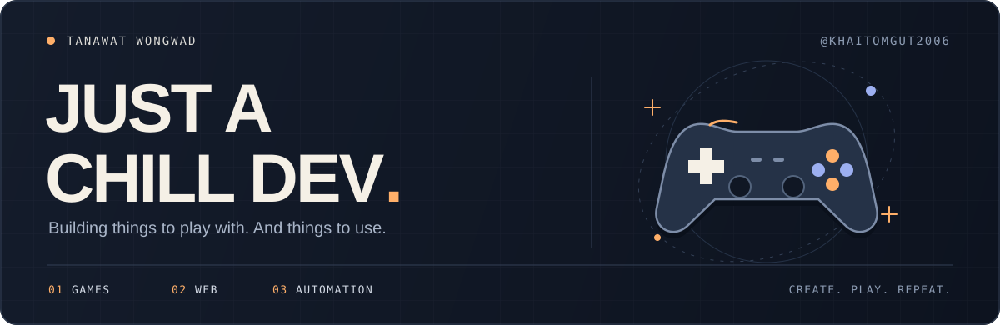
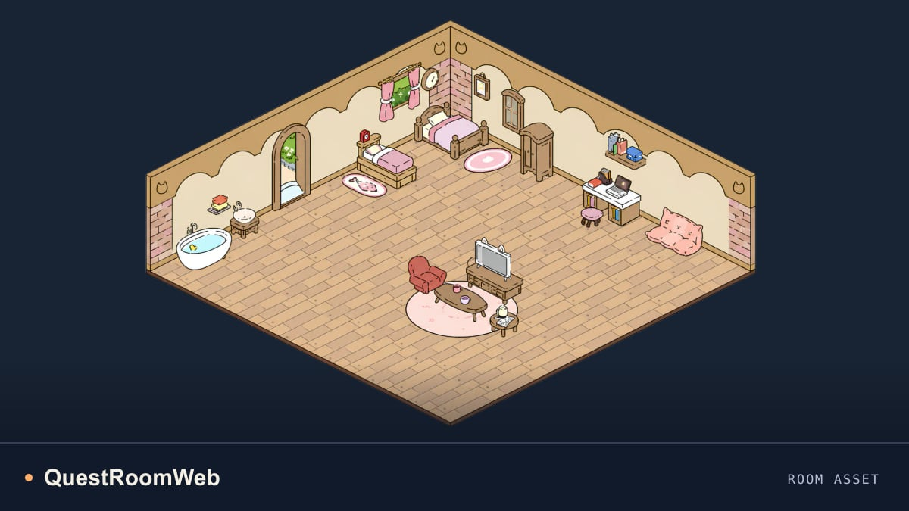
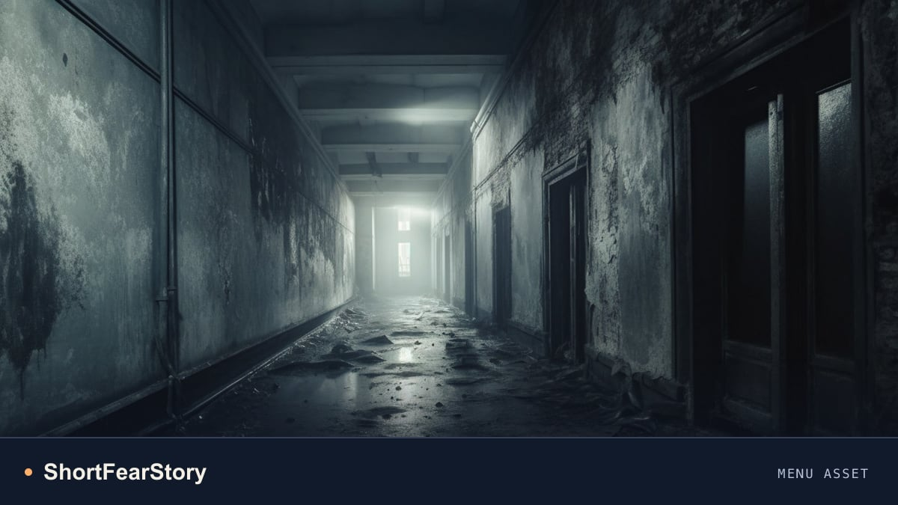
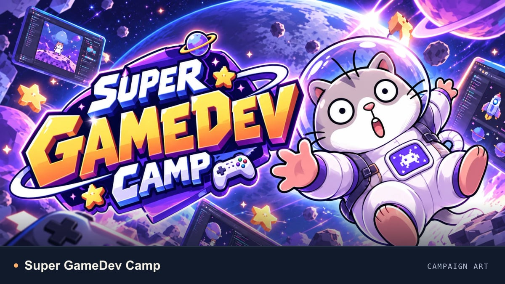
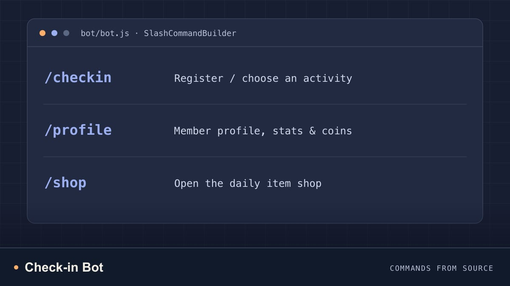
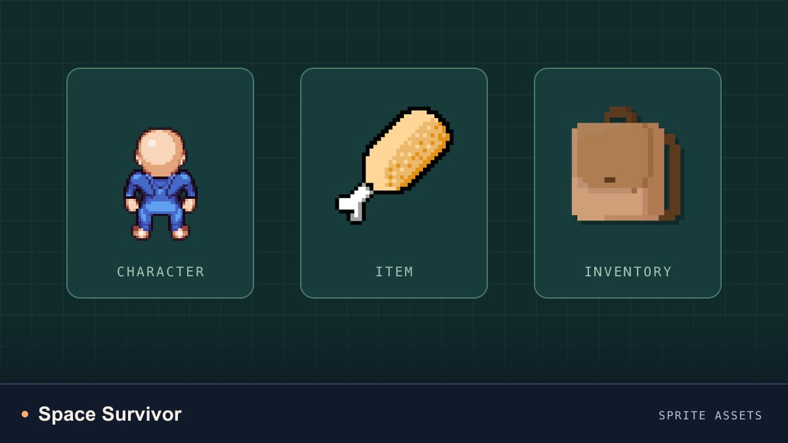
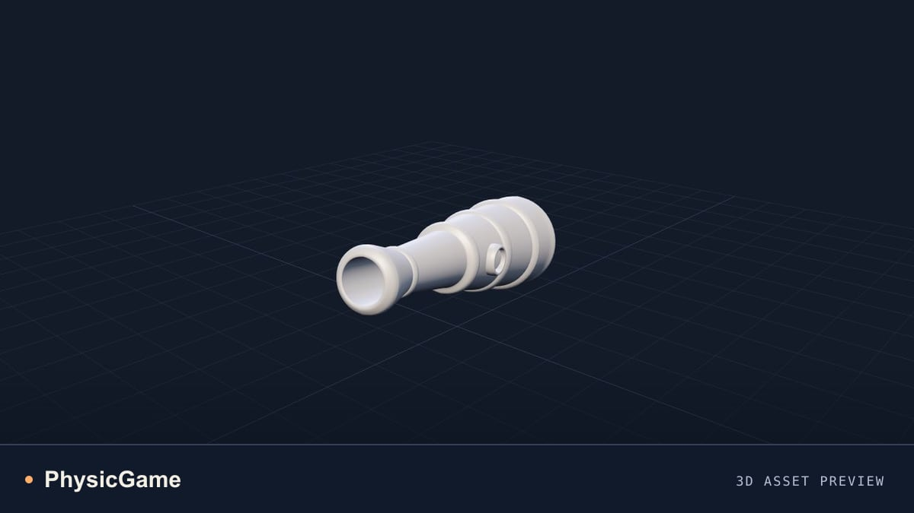

  

  <a href="#selected-projects">Selected projects</a> &nbsp;·&nbsp;
  <a href="#toolbox">Toolbox</a> &nbsp;·&nbsp;
  <a href="https://www.youtube.com/@KhaitomDev">YouTube</a> &nbsp;·&nbsp;
  <a href="https://github.com/KhaiTomGut2006?tab=repositories">All repositories ↗</a>

## Hey, I'm Tanawat.

I build **games, web experiences, and useful bots**. My projects span Unity and C# gameplay, interactive JavaScript websites, and Discord automation.

This is my corner of GitHub: a collection of things I've built, explored, and learned along the way.

## Selected projects

<table>
  <tr>
    <td width="50%" valign="top">
      
      <h3>01 / QuestRoomWeb</h3>
      
A web application combining React interfaces, real-time communication, and a MongoDB data layer.

      
<code>Next.js</code> <code>React</code> <code>Socket.IO</code> <code>MongoDB</code>

      
<a href="https://github.com/KhaiTomGut2006/QuestRoomWeb">Explore the code →</a>

    </td>
    <td width="50%" valign="top">
      
      <h3>02 / ShortFearStory</h3>
      
A Unity game project with dialogue, cutscenes, inventory, and object inspection systems.

      
<code>Unity</code> <code>C#</code> <code>Game development</code>

      
<a href="https://github.com/KhaiTomGut2006/ShortFearStory">Explore the code →</a>

    </td>
  </tr>
  <tr>
    <td width="50%" valign="top">
      
      <h3>03 / Super GameDev Camp</h3>
      
A space-themed camp website with SVG/CSS animation, on-demand 3D models, and reduced-motion support.

      
<code>JavaScript</code> <code>CSS</code> <code>SVG</code> <code>Three.js</code>

      
<a href="https://github.com/KhaiTomGut2006/SuperGameDevCampWeb">Explore the code →</a>

    </td>
    <td width="50%" valign="top">
      
      <h3>04 / Check-in Bot</h3>
      
A Discord bot project built with Node.js, with Express and MongoDB integrations.

      
<code>Node.js</code> <code>discord.js</code> <code>Express</code> <code>MongoDB</code>

      
<a href="https://github.com/KhaiTomGut2006/Check_in_Bot">Explore the code →</a>

    </td>
  </tr>
  <tr>
    <td width="50%" valign="top">
      
      <h3>05 / Space Survivor</h3>
      
A Unity game project exploring character systems, item attraction, inventory, and gameplay UI.

      
<code>Unity</code> <code>C#</code> <code>ScriptableObjects</code>

      
<a href="https://github.com/KhaiTomGut2006/Space-Survivor-Project">Explore the code →</a>

    </td>
    <td width="50%" valign="top">
      
      <h3>06 / PhysicGame</h3>
      
Another part of my game development collection, built with Unity and C#.

      
<code>Unity</code> <code>C#</code>

      
<a href="https://github.com/KhaiTomGut2006/PhysicGame">Explore the code →</a>

    </td>
  </tr>
</table>

Previews show project artwork, game assets, and commands from source. They are not gameplay or live application screenshots. <a href="./assets/projects/SOURCES.md">Image sources →</a>

More from the game shelf: [2D-Game-InwZa-007](https://github.com/KhaiTomGut2006/2D-Game-InwZa-007).

## Toolbox

| Games | Web | Bots & data |
| :--- | :--- | :--- |
| Unity · C# | JavaScript · React · Next.js | Node.js · discord.js · Express |
| Gameplay · UI · ScriptableObjects | HTML · CSS · SVG · Three.js | MongoDB · Mongoose · Socket.IO |

## Around the internet

[YouTube / @KhaitomDev](https://www.youtube.com/@KhaitomDev) &nbsp;·&nbsp; [Instagram / tanawat.gut](https://www.instagram.com/tanawat.gut/) &nbsp;·&nbsp; [Facebook / gut.tanawat](https://www.facebook.com/gut.tanawat)

---

Just a chill dev. One project at a time.

